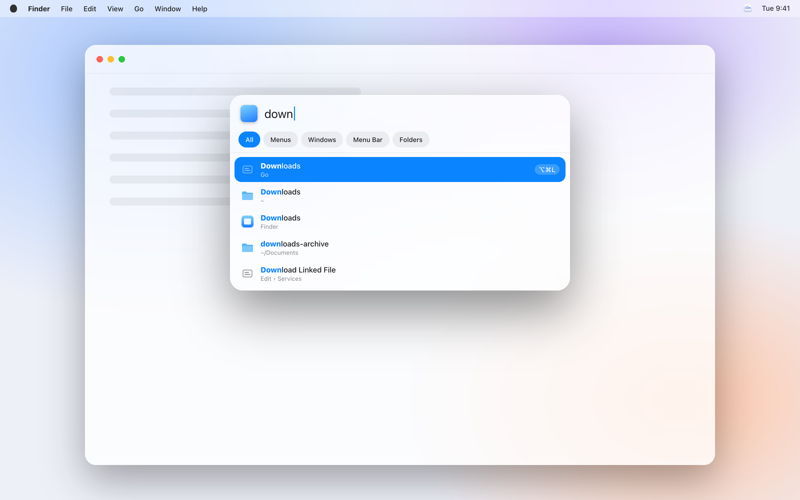

<p align="center">
  
</p>

<h1 align="center">JumpKey</h1>

<p align="center"><sub>Formerly MenuKey.</sub></p>

<p align="center">
  Search and run any menu command in the app you're using,<br>
  switch windows, open menu bar icons and find files and folders.<br>
  A free Spotlight alternative for Mac.<br>
  Press a shortcut, type a few letters, hit Return.
</p>

<p align="center">
  <a href="https://github.com/patrickfreyer/JumpKey/releases/latest"><b>Download for macOS</b></a> · <a href="https://jumpkey.white-forest-01f3.workers.dev">Website</a>
</p>


JumpKey started as the menu search from launchers like Alfred, as a tiny standalone app. It still has no clipboard history, workflows or Dock icon. It lives in your menu bar, and the binary is under 1 MB.

## Features

- **Any app, every menu.** Reads the menu bar of the frontmost app through macOS Accessibility, including submenus like *File › Open Recent*.
- **Fuzzy search.** `nwfo` finds *New Folder*. Words can match the item or the menu it's in, so `view side` finds *View › Show Sidebar*.
- **Learns like zoxide.** Results are ranked by *frecency*: how often and how recently you used them. JumpKey also remembers what you typed, so if `t` always ends in *New Tab*, `t` will put it first.
- **Plain-English fallback.** When nothing matches well, JumpKey asks Apple's on-device model what you meant: `make text bigger` finds *View › Zoom In*. It runs only then, takes under a second and never leaves your Mac.
- **Windows.** Search the open windows of every app and jump to one. Optional small previews.
- **Menu bar icons.** Open Wi-Fi, Battery, Control Center or any app's menu bar icon by name.
- **Files and folders, faster than Spotlight.** Tab to *Files* and type part of a name. Results come from Spotlight and your [zoxide](https://github.com/ajeetdsouza/zoxide) database, ranked by how often and how recently you open them. Return opens a file in its app or a folder in Finder; ⌘Return shows a file in Finder or opens a folder in your terminal. Type `z proj` to jump to folders only, like zoxide, and every folder jump is added back to zoxide so `z` in your terminal learns too. The first time, JumpKey asks to search your Desktop, Documents and Downloads, because macOS hides them from Spotlight searches by other apps until you allow it.
- **Shows keyboard shortcuts and checkmarks** next to each result, with the letters you typed highlighted.
- **Fast.** A typical app's menus are read in 30–80 ms, and even huge ones like Safari's history menus take around 150 ms.
- **Liquid Glass panel** that follows light and dark mode, with large rows you can tap on a touch screen.
- **Stays out of the way.** The panel never steals focus from your app, so the menu commands work exactly as if you'd clicked them.



## Install

1. Download `JumpKey.zip` from the [latest release](https://github.com/patrickfreyer/JumpKey/releases/latest), unzip it and move **JumpKey.app** to **Applications**.
2. Open it. The release isn't notarized yet, so the first time macOS may refuse to open it: go to **System Settings → Privacy & Security** and click **Open Anyway**. Or run:
   ```bash
   xattr -dr com.apple.quarantine /Applications/JumpKey.app
   ```
3. Turn on **JumpKey** under **System Settings → Privacy & Security → Accessibility**. JumpKey needs this to read and click menus. It doesn't record keystrokes or send anything anywhere.
4. Optional: for window previews, turn on **Window Previews** in JumpKey's menu and allow **Screen Recording** when asked. For plain-English search, turn on Apple Intelligence.

JumpKey turns on **Launch at Login** the first time it runs. You can switch that off in its menu bar menu.

Requires macOS 26 Tahoe or later.

## Use

| Key | Action |
| --- | --- |
| <kbd>⌥</kbd> <kbd>Space</kbd> | Open or close JumpKey (changeable) |
| <kbd>↑</kbd> <kbd>↓</kbd> or <kbd>⌃N</kbd> <kbd>⌃P</kbd> | Move the selection |
| <kbd>Tab</kbd> / <kbd>⇧Tab</kbd> | Switch between All, Menus, Windows, Menu Bar and Files |
| <kbd>Return</kbd> | Run the selected item |
| <kbd>⌘</kbd> <kbd>Return</kbd> | On a file: show it in Finder. On a folder: open it in your terminal |
| Shortcut twice, quickly | Repeat the last command |
| <kbd>Esc</kbd> | Close |

Start a search with `z ` to go straight to folders.

You can also click or tap a result.

From the menu bar icon you can:

- **Change the shortcut:** ⌥Space, ⌃⌥Space, ⇧⌘Space, ⌥⌘M, or ⇧⌘/ (replaces the macOS Help menu search).
- Pick the terminal folders open in (Terminal, iTerm, Ghostty, Warp, WezTerm, kitty, Alacritty, Hyper).
- Turn window previews and plain-English search on or off.
- Include the Apple  menu in results.
- Turn Launch at Login on or off.

## Build from source

You need Xcode 26 or later.

```bash
git clone https://github.com/patrickfreyer/JumpKey.git
cd JumpKey
./Scripts/build-app.sh
```

This builds `build/JumpKey.app`, signs it with your first code-signing identity (or ad hoc if you have none), and installs it in `/Applications`.

A few other scripts:

- `swift Scripts/make-icon.swift` redraws the app icon.
- `./Scripts/make-mockups.sh` re-renders the README images from `docs/mockup.html` with Chrome.
- `./Scripts/deploy-site.sh` publishes the website (`docs/index.html`) to Cloudflare Workers at [the website](https://jumpkey.white-forest-01f3.workers.dev).
- `swift Scripts/make-icon.swift sheet out.png` renders the alternative icon designs side by side.
- `JumpKey.app/Contents/MacOS/JumpKey` with `--dump Finder "new fo"`, `--windows`, `--extras`, `--files invoice` or `--ask Finder "make icons bigger"` prints what JumpKey sees, without the UI.

## How it works

When you press the shortcut, JumpKey notes the frontmost app and opens a non-activating panel, so that app stays active. On background threads it walks the app's `AXMenuBar` with the Accessibility API, lists every app's windows, and reads the menu bar icons. Choosing a result sends it an `AXPress` or raises the window, the same thing that happens when you click it.

Folder search shells out to `zoxide query` and `mdfind`. The plain-English fallback uses the [Foundation Models](https://developer.apple.com/documentation/foundationmodels) framework to turn your request into likely menu titles, which are then matched against the real menu, so it can only suggest commands that exist. Usage history is a small JSON file in `~/Library/Application Support/JumpKey`.

The whole app is about 2,000 lines of Swift in [`Sources/JumpKey`](Sources/JumpKey).

## License

[MIT](LICENSE)
