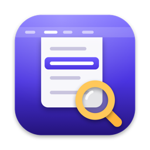
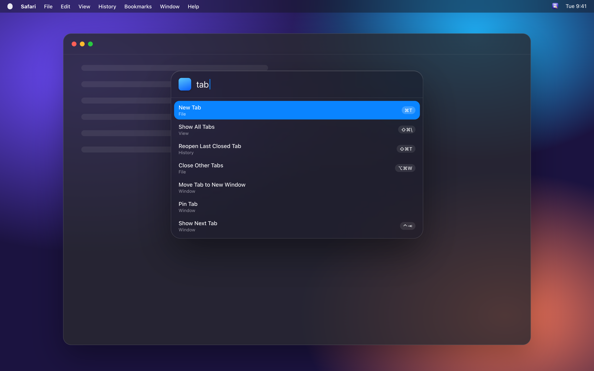

<p align="center">
  
</p>

<h1 align="center">MenuKey</h1>

<p align="center">
  Search and run any menu command in the app you're using.<br>
  Press a shortcut, type a few letters, hit Return.
</p>

<p align="center">
  <a href="https://github.com/patrickfreyer/MenuKey/releases/latest"><b>Download for macOS</b></a>
</p>



MenuKey does one thing: the menu search from launchers like Alfred, as a tiny standalone app. No clipboard history, no workflows, no Dock icon. It lives in your menu bar, and the binary is under 1 MB.

## Features

- **Any app, every menu.** Reads the menu bar of the frontmost app through macOS Accessibility, including submenus like *File › Open Recent*.
- **Fuzzy search.** `nwfo` finds *New Folder*. Words can match the item or the menu it's in, so `view side` finds *View › Show Sidebar*.
- **Learns what you use.** Items you run often rise to the top for each app.
- **Shows keyboard shortcuts** next to each result, so you pick them up as you go.
- **Fast.** A typical app's menus are read in 30–80 ms, and even huge ones like Safari's history menus take around 150 ms.
- **Liquid Glass panel** that follows light and dark mode, with large rows you can tap on a touch screen.
- **Stays out of the way.** The panel never steals focus from your app, so the menu commands work exactly as if you'd clicked them.


## Install

1. Download `MenuKey.zip` from the [latest release](https://github.com/patrickfreyer/MenuKey/releases/latest), unzip it and move **MenuKey.app** to **Applications**.
2. Open it. The release isn't notarized yet, so the first time macOS may refuse to open it: go to **System Settings → Privacy & Security** and click **Open Anyway**. Or run:
   ```bash
   xattr -dr com.apple.quarantine /Applications/MenuKey.app
   ```
3. Turn on **MenuKey** under **System Settings → Privacy & Security → Accessibility**. MenuKey needs this to read and click menus. It doesn't record keystrokes or send anything anywhere.

MenuKey turns on **Launch at Login** the first time it runs. You can switch that off in its menu bar menu.

Requires macOS 26 Tahoe or later.

## Use

| Key | Action |
| --- | --- |
| <kbd>⌥</kbd> <kbd>Space</kbd> | Open or close MenuKey (changeable) |
| <kbd>↑</kbd> <kbd>↓</kbd> or <kbd>⌃N</kbd> <kbd>⌃P</kbd> | Move the selection |
| <kbd>Return</kbd> | Run the selected menu item |
| <kbd>Esc</kbd> | Close |

You can also click or tap a result.

From the menu bar icon you can:

- **Change the shortcut:** ⌥Space, ⌃⌥Space, ⇧⌘Space, ⌥⌘M, or ⇧⌘/ (replaces the macOS Help menu search).
- Include the Apple  menu in results.
- Turn Launch at Login on or off.

## Build from source

You need Xcode 26 or later.

```bash
git clone https://github.com/patrickfreyer/MenuKey.git
cd MenuKey
./Scripts/build-app.sh
```

This builds `build/MenuKey.app`, signs it with your first code-signing identity (or ad hoc if you have none), and installs it in `/Applications`.

A few other scripts:

- `swift Scripts/make-icon.swift` redraws the app icon.
- `./Scripts/make-mockups.sh` re-renders the README images from `docs/mockup.html` with Chrome.
- `MenuKey.app/Contents/MacOS/MenuKey --dump Finder "new fo"` prints what MenuKey sees for an app, without the UI.

## How it works

When you press the shortcut, MenuKey notes the frontmost app and opens a non-activating panel, so that app stays active. On a background thread it walks the app's `AXMenuBar` with the Accessibility API and collects every enabled item along with its menu path and shortcut. Choosing a result sends that item an `AXPress`, the same thing that happens when you click it.

The whole app is about 800 lines of Swift in [`Sources/MenuKey`](Sources/MenuKey).

## License

[MIT](LICENSE)
